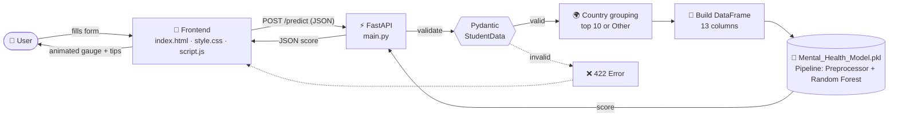
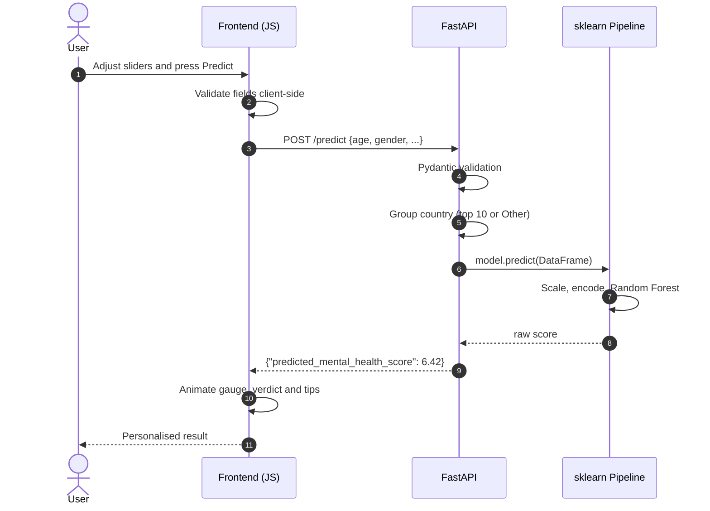
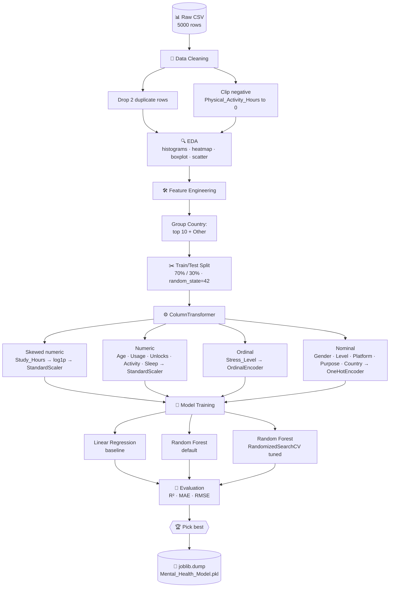
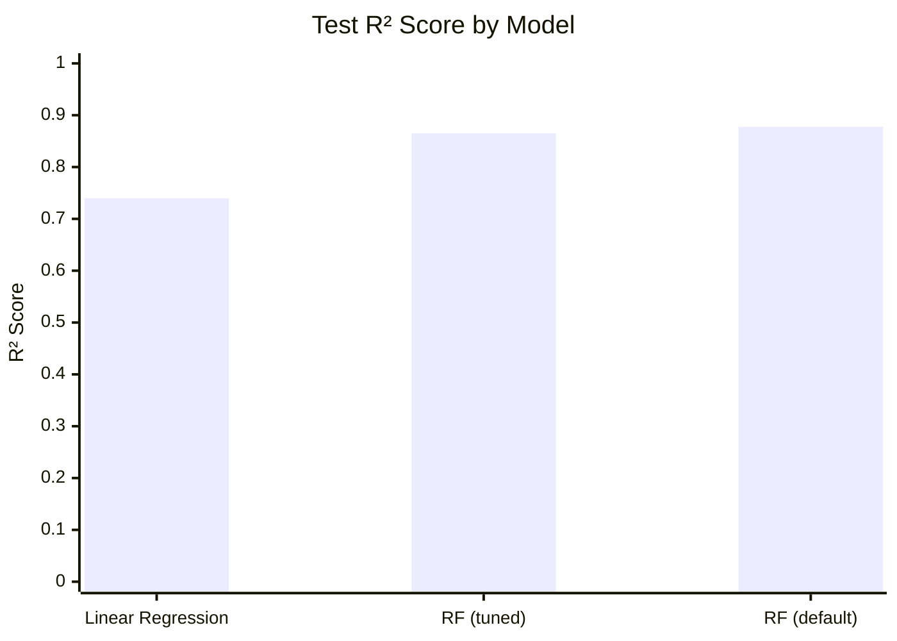
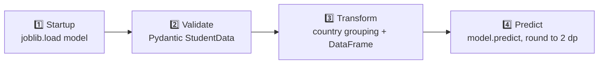

<div align="center">


<a href="https://git.io/typing-svg">
  
</a>

<br/>


-0.8776-brightgreen?style=flat-square)


</div>

---

## 📑 Table of Contents

1. [Overview](#-overview)
2. [Live Demo Preview](#-live-demo-preview)
3. [Key Features](#-key-features)
4. [System Architecture](#-system-architecture)
5. [Project Structure](#-project-structure)
6. [Dataset](#-dataset)
7. [Machine Learning Workflow](#-machine-learning-workflow)
8. [Model Details & Accuracy](#-model-details--accuracy)
9. [How the Backend Works](#-how-the-backend-works-fastapi)
10. [How the Frontend Works](#-how-the-frontend-works)
11. [API Reference](#-api-reference)
12. [Installation & Running](#-installation--running)
13. [How to Interpret the Score](#-how-to-interpret-the-score)
14. [Limitations & Future Work](#-limitations--future-work)
15. [Disclaimer](#-disclaimer)

---

## 🧠 Overview

**MindPulse** is an end-to-end Machine Learning web application that estimates a student's **Mental Health Score** from their daily habits: social media usage, phone unlocks, study time, physical activity, sleep and stress level.

The project covers the whole data science lifecycle:

| Stage | What happens |
|-------|--------------|
| 📊 **Data** | 5,000 student records are explored, cleaned and engineered |
| 🤖 **Model** | A scikit-learn `Pipeline` (preprocessing + Random Forest) is trained and tuned |
| 💾 **Serialization** | The full pipeline is saved as `Mental_Health_Model.pkl` with `joblib` |
| ⚡ **Backend** | A FastAPI server validates input with Pydantic and serves predictions |
| 🎨 **Frontend** | A dark, neon, glassmorphism UI built with pure HTML, CSS and JS calls the API |

---

## 🖼️ Live Demo Preview


---

## ✨ Key Features

- 🎯 **Real-time predictions**: results appear in about a second
- 🧩 **Full sklearn Pipeline**: preprocessing and model live in one pickle, so there is no train/serve skew
- 🛡️ **Strict input validation**: Pydantic `Literal` types and numeric ranges reject bad data
- 🌍 **Smart country handling**: unseen countries are grouped as `Other`, matching training
- 📈 **Animated score gauge**: SVG ring with a number counter and a gradient stroke
- 💡 **Personalised tips**: rule-based suggestions for sleep, screen time, stress and activity
- 🟢 **Live API status badge**: the page shows whether the backend is online
- 📱 **Responsive design**: works on desktop, tablet and phone
- 🔓 **CORS enabled**: the frontend can be opened straight from disk

---

## 🏗️ System Architecture



### Request lifecycle



---

## 📂 Project Structure

```text
📦 Mental-Health-Score-Predictor
 ┣ 📁 __pycache__/                                   # Python bytecode cache (auto-generated)
 ┣ 📁 docs/                                          # 🖼️ Screenshots for this README (add yours)
 ┣ 📓 Code.ipynb                                     # EDA, preprocessing, training, tuning, export
 ┣ 📊 Student Social Media And Mental Health Impact.csv   # Raw dataset (5000 rows × 13 cols)
 ┣ 🤖 Mental_Health_Model.pkl                        # Serialized sklearn Pipeline
 ┣ ⚡ main.py                                        # FastAPI backend (API + validation)
 ┣ 📄 requirements.txt                               # Python dependencies
 ┣ 🌐 index.html                                     # Frontend markup
 ┣ 🎨 style.css                                      # Neon glassmorphism theme
 ┣ 🧠 script.js                                      # Frontend logic (API calls, gauge, tips)
 ┗ 📝 README.md                                      # You are here
```

### What each file does

| File | Role |
|------|------|
| `Code.ipynb` | The complete ML notebook: data loading, cleaning, EDA plots, feature engineering, model comparison, hyper-parameter search and model export |
| `Mental_Health_Model.pkl` | The trained `Pipeline` (ColumnTransformer + RandomForestRegressor), loaded once at server start |
| `main.py` | Defines the `StudentData` schema, the `/` health route and the `/predict` route |
| `index.html` | Semantic form with 3 sections: About you, Social media habits, Daily lifestyle, plus the result card |
| `style.css` | Design tokens, animated background blobs, glass cards, custom sliders, gauge animation |
| `script.js` | Slider UI, stress pills, API health check, validation, `fetch`, gauge animation, tips engine |

---

## 📊 Dataset

**Source file:** `Student Social Media And Mental Health Impact.csv`

| Property | Value |
|----------|-------|
| Rows | 5,000 (4,998 after removing 2 duplicates) |
| Columns | 13 (12 inputs + 1 target) |
| Missing values | 0 |
| Target | `Mental_Health_Score` (range 3.6 to 9.4, mean about 6.23) |
| Age range | 18 to 24 |

### Columns

| Column | Type | Description |
|--------|------|-------------|
| `Age` | int | Student age |
| `Gender` | category | Male / Female |
| `Country` | category | 111 unique values, grouped to the top 10 plus `Other` |
| `Academic_Level` | category | High School / Undergraduate / Graduate |
| `Most_Used_Platform` | category | 12 platforms (Instagram, TikTok, ...) |
| `Purpose_Of_Use` | category | Networking / Education / Entertainment / News |
| `Avg_Daily_Usage_Hours` | float | Daily social media hours |
| `Daily_Unlocks` | int | Phone unlocks per day |
| `Study_Hours` | float | Daily study hours |
| `Physical_Activity_Hours` | float | Daily exercise hours |
| `Sleep_Hours_Per_Night` | float | Nightly sleep hours |
| `Stress_Level` | ordinal | Low < Medium < High < Very High |
| `Mental_Health_Score` | float | 🎯 **Target** |

### Key EDA findings

- 📉 **Higher social media usage tends to go with a lower score**
- 😴 **More sleep tends to go with a higher score**
- 😰 **Stress level separates scores clearly** (visible in the boxplot)
- 🔔 Daily unlocks correlate strongly with usage hours

---

## 🔄 Machine Learning Workflow



### Preprocessing in detail

| Feature group | Columns | Transformer | Why |
|---------------|---------|-------------|-----|
| **Skewed numeric** | `Study_Hours` | `log1p` then `StandardScaler` | Skewness of 0.44 (the highest of all numeric features), so log compresses the tail |
| **Plain numeric** | `Age`, `Avg_Daily_Usage_Hours`, `Daily_Unlocks`, `Physical_Activity_Hours`, `Sleep_Hours_Per_Night` | `StandardScaler` | Roughly symmetric, only needs scaling |
| **Ordinal** | `Stress_Level` | `OrdinalEncoder` (Low, Medium, High, Very High) | Stress has a natural order |
| **Nominal** | `Gender`, `Academic_Level`, `Most_Used_Platform`, `Purpose_Of_Use`, `Grouped_country` | `OneHotEncoder(handle_unknown="ignore")` | No order, and unseen categories won't crash prediction |

---

## 🏆 Model Details & Accuracy

Three models were trained and compared on a **30% hold-out test set** (1,500 samples).

| Model | R² (Test) | R² (Train) | MAE | RMSE |
|-------|:---------:|:----------:|:---:|:----:|
| Linear Regression | 0.7398 | 0.7237 | 0.5362 | 0.6760 |
| **Random Forest (default)** ⭐ | **0.8776** | 0.9808 | **0.3472** | **0.4637** |
| Random Forest (tuned) | 0.8650 | 0.9547 | 0.3689 | 0.4869 |



### Reading the results

- ✅ **Random Forest beats Linear Regression** by about 14 R² points, so the relationship between habits and mental health is **non-linear**.
- 📏 **MAE of 0.347** means predictions are off by about **±0.35 points** on a roughly 1 to 10 scale.
- ⚖️ **Overfitting note:** the default forest scores 0.98 on training data and 0.88 on test data (a gap of about 0.10). The tuned forest narrows that gap to about 0.09 with only a small test-score drop. Both are reasonable, and the tuned model generalises slightly more conservatively.
- 💾 The exported `Mental_Health_Model.pkl` is the **default Random Forest pipeline** (`rf_pipeline`), which had the best test score.

### Hyper-parameter search (RandomizedSearchCV)

| Setting | Value |
|---------|-------|
| Search space | `n_estimators` [100, 200, 300] · `max_depth` [5, 10, 15] · `min_samples_split` [2, 5, 10] · `min_samples_leaf` [1, 2, 4] |
| Iterations | 15 |
| Cross-validation | 5-fold |
| Scoring | R² |
| Best params | `n_estimators=200`, `max_depth=15`, `min_samples_split=5`, `min_samples_leaf=2` |

---

## ⚡ How the Backend Works (FastAPI)

`main.py` does four jobs:



1. **Load once.** The pickle is loaded at import time, so every request reuses the same in-memory model.
2. **Validate.** `StudentData` enforces allowed values (for example `gender` can only be `Male` or `Female`) and numeric ranges (`age` 10 to 100, hours 0 to 24).
3. **Transform.** Any country outside the top-10 list becomes `"Other"`, exactly as in training. The request is converted to a single-row `DataFrame` whose column names match the training data.
4. **Predict.** `model.predict()` runs the whole pipeline (scale, encode, forest) and the score is rounded to 2 decimals.

> ℹ️ The DataFrame also contains a raw `Country` column. The pipeline's `ColumnTransformer` ignores columns it wasn't trained on, so only `Grouped_country` is used.

---

## 🎨 How the Frontend Works

| Piece | Behaviour |
|-------|-----------|
| **Sliders** | The filled track and the hour value update live as you drag |
| **Stress pills** | A segmented control (Low, Medium, High, Very High) |
| **Health check** | `GET /` every 15 seconds toggles the green or red status badge |
| **Validation** | Age, country and unlocks are checked before the request is sent |
| **Prediction** | `fetch POST /predict`, then the gauge ring and number counter animate |
| **Verdict** | Thriving, Balanced or Needs attention, based on score ÷ 10 |
| **Tips** | Rule-based advice (sleep under 7 h, usage over 5 h, unlocks over 100, ...) |
| **Errors** | Server validation errors (HTTP 422) are parsed and shown in readable form |

---

## 📡 API Reference

### `GET /`
Health check.

```json
{ "message": "Welcome to Sheryians AI School Guys" }
```

### `POST /predict`

**Request body**

```json
{
  "age": 21,
  "gender": "Female",
  "country": "India",
  "academic_level": "Undergraduate",
  "most_used_platform": "Instagram",
  "purpose_of_use": "Entertainment",
  "avg_daily_usage_hours": 4.5,
  "daily_unlocks": 120,
  "study_hours": 3.0,
  "physical_activity_hours": 1.0,
  "sleep_hours_per_night": 7.0,
  "stress_level": "Medium"
}
```

**Response**

```json
{ "predicted_mental_health_score": 6.42 }
```

**Allowed values**

| Field | Allowed |
|-------|---------|
| `gender` | `Male`, `Female` |
| `academic_level` | `High School`, `Undergraduate`, `Graduate` |
| `most_used_platform` | `Facebook`, `LinkedIn`, `Instagram`, `Snapchat`, `Twitter`, `YouTube`, `TikTok`, `LINE`, `KakaoTalk`, `VKontakte`, `WhatsApp`, `WeChat` |
| `purpose_of_use` | `Networking`, `Education`, `Entertainment`, `News` |
| `stress_level` | `Low`, `Medium`, `High`, `Very High` |
| `age` | 10 to 100 |
| hours fields | 0 to 24 |
| `daily_unlocks` | ≥ 0 |

**cURL example**

```bash
curl -X POST "http://127.0.0.1:8000/predict" \
  -H "Content-Type: application/json" \
  -d '{"age":21,"gender":"Female","country":"India","academic_level":"Undergraduate","most_used_platform":"Instagram","purpose_of_use":"Entertainment","avg_daily_usage_hours":4.5,"daily_unlocks":120,"study_hours":3,"physical_activity_hours":1,"sleep_hours_per_night":7,"stress_level":"Medium"}'
```

Interactive Swagger docs are available at **http://127.0.0.1:8000/docs** once the server is running.

---

## 🚀 Installation & Running

### 1️⃣ Clone the repository

```bash
git clone https://github.com/<your-username>/<your-repo>.git
cd <your-repo>
```

### 2️⃣ Create a virtual environment (recommended)

```bash
python -m venv venv
# Windows
venv\Scripts\activate
# macOS / Linux
source venv/bin/activate
```

### 3️⃣ Install dependencies

```bash
pip install -r requirements.txt
```

If you need to create `requirements.txt`, use:

```text
fastapi
uvicorn
pandas
numpy
scikit-learn
joblib
pydantic
```

> ⚠️ **Important:** install the **same scikit-learn version** the model was trained with (check with `pip show scikit-learn` in your notebook environment, and pin it, e.g. `scikit-learn==1.6.1`). A pickle created in one version may fail to load in another.

### 4️⃣ Start the backend

```bash
uvicorn main:app --reload
```

The server runs at `http://127.0.0.1:8000`.

### 5️⃣ Open the frontend

Double-click **`index.html`**, or serve the folder:

```bash
python -m http.server 5500
# then open http://localhost:5500
```

The status badge in the top-right corner should turn **green** ("API online").

### 🔁 Re-train the model (optional)

Open `Code.ipynb` (Jupyter or Google Colab), place the CSV in the same folder, and run all cells. The last cell exports a fresh `Mental_Health_Model.pkl`.

---

## 🧭 How to Interpret the Score

The dataset target ranges from about **3.6 to 9.4** and is treated as a score out of 10.

| Score | Verdict in the UI | Meaning |
|:-----:|-------------------|---------|
| **7.0 to 10** | 🟢 Thriving | Habits point to a healthy mental state |
| **5.0 to 6.9** | 🟡 Balanced, with room to grow | Okay, but lifestyle tweaks could help |
| **Below 5.0** | 🔴 Needs attention | Pattern suggests added strain |

> These bands are UI heuristics for readability, not clinical thresholds.

---

## 🔭 Limitations & Future Work

**Limitations**

- The dataset appears synthetic or survey-style and covers ages 18 to 24 only, so predictions for other ages are extrapolations.
- The score is a statistical estimate based on correlations, **not a causal or clinical measurement**.
- The default Random Forest shows a train/test gap, so more data or regularisation could help.

**Roadmap**

- [ ] Add SHAP or feature-importance explanations to the result card
- [ ] Try Gradient Boosting, XGBoost and LightGBM
- [ ] Dockerize the app (`Dockerfile` + `docker-compose.yml`)
- [ ] Deploy the API (Render, Railway or AWS) and the UI (GitHub Pages or Netlify)
- [ ] Add unit tests for `/predict`
- [ ] Store anonymous prediction history with consent

---

## ⚠️ Disclaimer

This project is for **educational purposes only**. It is **not** a medical or psychological diagnostic tool. If you or someone you know is struggling with mental health, please reach out to a qualified professional or a local support service.

---

<div align="center">

### ⭐ If you like this project, give it a star!

Built with ❤️ using **FastAPI**, **scikit-learn** and a lot of neon.


</div>
